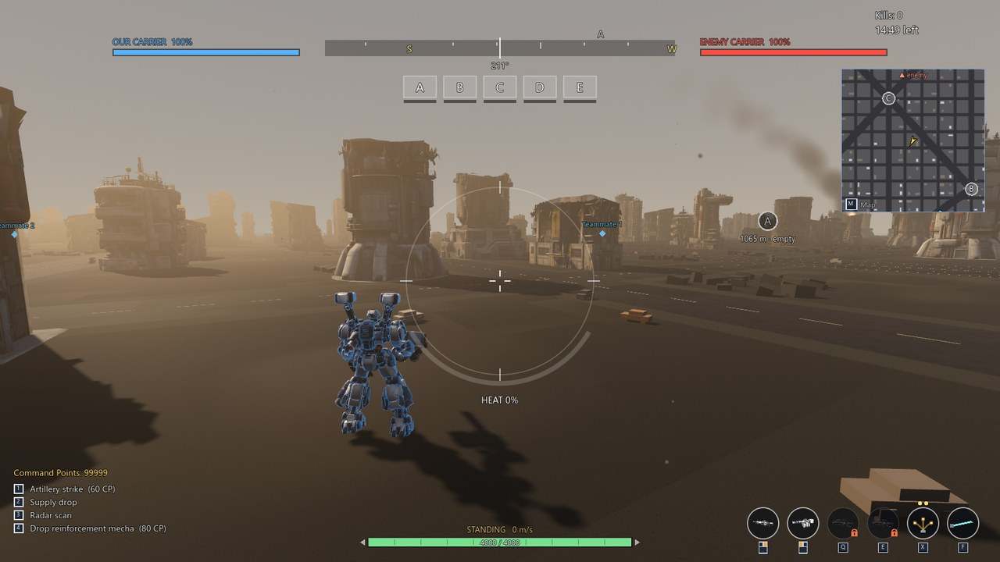
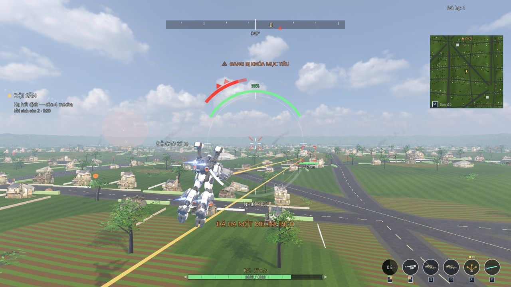

# Game Mecha

A 3D mecha combat game for Windows, made with **Godot 4.7.2**. Pilot a 10-metre-tall mecha for the **Union** (blue) against the **Empire** (red): skate, boost, fly, shoot, fire shoulder missiles, deploy flares and lunge-slash enemy mechas.

*Tiếng Việt ở bên dưới.*

## Download and play

1. Open **[Releases](../../releases)** and download the latest `GameMecha_Windows.zip`.
2. Unzip it anywhere and run **`GameMecha.exe`**. No install needed.

Windows may show a "Windows protected your PC" warning because the game is not signed: click **More info → Run anyway**.

Recommended: a graphics card on the level of a GTX 1060 / RTX 2060 or better. If the game is slow, open **Settings → Graphics quality** and pick **Low** or **Medium**.

## Game modes

- **Campaign**: a training range with 6 lessons (each one explained before it starts), then 4 solo missions on large maps — enemies patrol and only attack once they spot you.
- **Capture points**: 3v3 or 6v6 with bots. Take 5 capture points, build missile stations to bring down the enemy carrier in the sky.
- 3 maps (ruined city, suburbs, countryside), 4 mecha types, 7 hand weapons, upgrades, save / load.
- Languages: English, 日本語, Tiếng Việt (globe button at the top right of the main menu).

## Controls (rebindable in Settings → Controls)

| Key | Action |
|---|---|
| W A S D | Skate |
| Shift | Tap: boost dash · Hold: fast skate (both heat the engine) · Tap at the right moment: dodge a lunge |
| Space (hold) | Fly up |
| Ctrl | On the ground: walk / skate · In the air: hold altitude |
| T | Drop fast |
| Left / right mouse | Right-arm / left-arm weapon |
| Q / E | Left / right shoulder arm (missiles, shield, …) |
| X | Flares (missiles chasing you lose their lock) |
| F | Slash · when an **F** shows next to a locked enemy: lunge slash · tap at the right moment: parry |
| B | Loadout |
| M | Map |
| 1–4 | Call carrier support (capture points mode) |
| Esc | Back / pause |

Overheating stops you from flying and boosting until the engine has cooled down — watch the arc under the reticle.

## Run from source

1. Install [Godot 4.7.2](https://godotengine.org/download/archive/) (standard version).
2. In Godot: **Import** → choose `project.godot` in this folder → press **F5**.

The first import takes a few minutes. Technical notes (in Vietnamese): [TAI_LIEU_KY_THUAT.md](TAI_LIEU_KY_THUAT.md).

## Credits

See [GHI_CONG.md](GHI_CONG.md) (also shown in the in-game **Credits** screen).

---

# Game Mecha (Tiếng Việt)

Game bắn mecha 3D cho Windows, làm bằng **Godot 4.7.2**. Lái mecha cao 10 m của phe **Liên Hiệp** (xanh) đánh phe **Đế Chế** (đỏ): lướt, bật lao, bay, bắn, phóng tên lửa vai, thả pháo nhiệt, lao chém.

## Tải và chơi

1. Vào mục **[Releases](../../releases)**, tải `GameMecha_Windows.zip` mới nhất.
2. Giải nén ra đâu cũng được rồi chạy **`GameMecha.exe`**. Không cần cài đặt.

Windows có thể báo "Windows protected your PC" vì game chưa được ký số: bấm **More info → Run anyway**.

Nên có card đồ họa cỡ GTX 1060 / RTX 2060 trở lên. Nếu game giật, vào **Cài đặt → Chất lượng đồ họa** chọn **Thấp** hoặc **Vừa**.

## Chế độ chơi

- **Chiến dịch**: bãi huấn luyện 6 bài (trước mỗi bài có bảng hướng dẫn), rồi 4 nhiệm vụ đi một mình trên bản đồ rộng — địch đi tuần, chỉ tấn công khi phát hiện bạn.
- **Chiếm cứ điểm**: 3 đấu 3 hoặc 6 đấu 6 cùng bot. Giành 5 cứ điểm, dựng trạm tên lửa để hạ tàu sân bay địch trên trời.
- 3 bản đồ (thành phố đổ nát, ngoại ô, đồng quê), 4 loại mecha, 7 vũ khí tay, nâng cấp, lưu / tải.
- Ngôn ngữ: English, 日本語, Tiếng Việt (nút quả địa cầu góc trên phải menu chính).

## Phím (đổi được ở Cài đặt → Điều khiển)

| Phím | Tác dụng |
|---|---|
| W A S D | Lướt |
| Shift | Bấm: bật lao · Giữ: lướt nhanh (đều làm nóng động cơ) · Bấm đúng lúc: né cú lao chém |
| Space (giữ) | Bay lên |
| Ctrl | Dưới đất: chạy bộ / lướt · Trên không: giữ độ cao |
| T | Rơi nhanh |
| Chuột trái / phải | Vũ khí tay phải / trái |
| Q / E | Tay phụ trái / phải (tên lửa, khiên, …) |
| X | Pháo nhiệt (tên lửa đang đuổi mất khóa) |
| F | Chém · địch đang khóa có chữ **F** bên cạnh: lao chém · bấm đúng lúc: đỡ |
| B | Bảng trang bị |
| M | Bản đồ |
| 1–4 | Gọi hỗ trợ từ tàu sân bay (chế độ cứ điểm) |
| Esc | Lùi lại / tạm dừng |

Quá nhiệt thì không bay, không bật lao được tới khi động cơ nguội — xem cung dưới vòng ngắm.

## Chạy từ mã nguồn

1. Cài [Godot 4.7.2](https://godotengine.org/download/archive/) (bản thường).
2. Trong Godot: **Import** → chọn `project.godot` trong thư mục này → bấm **F5**.

Lần đầu Godot cần vài phút để nạp mô hình. Ghi chú kỹ thuật: [TAI_LIEU_KY_THUAT.md](TAI_LIEU_KY_THUAT.md).

## Ghi công

Xem [GHI_CONG.md](GHI_CONG.md) (cũng có ở màn **Ghi công** trong game).
